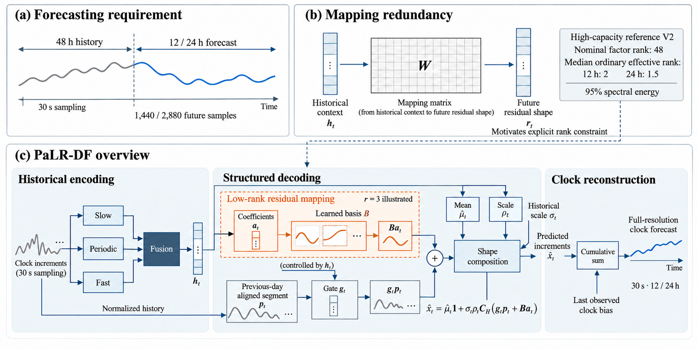
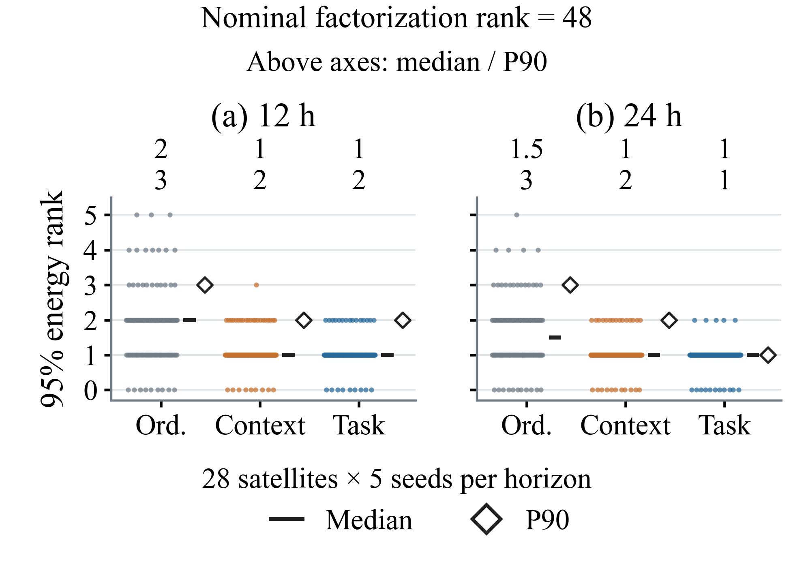
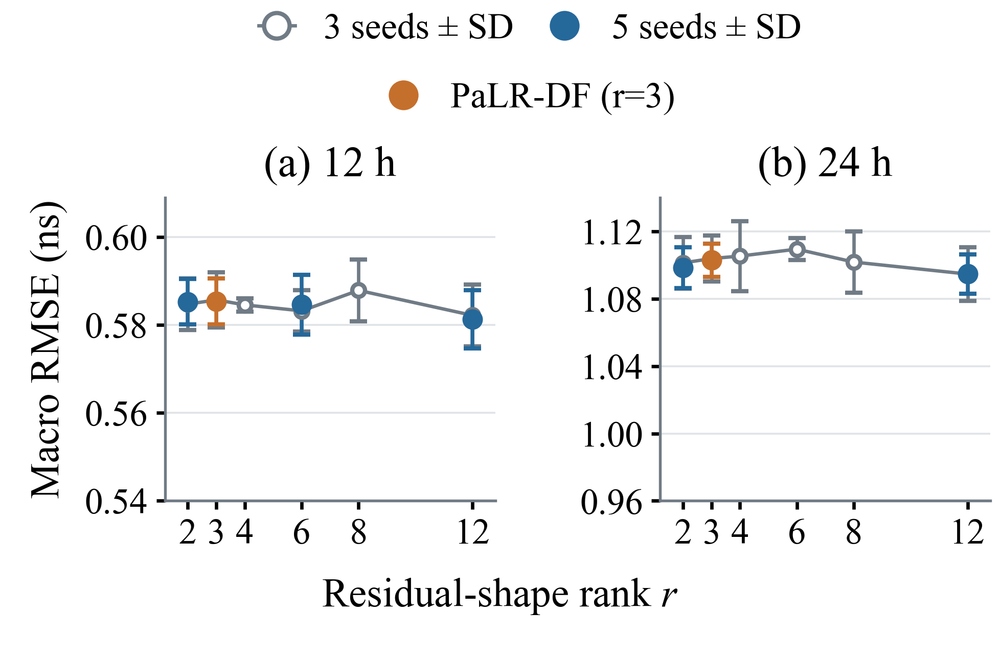
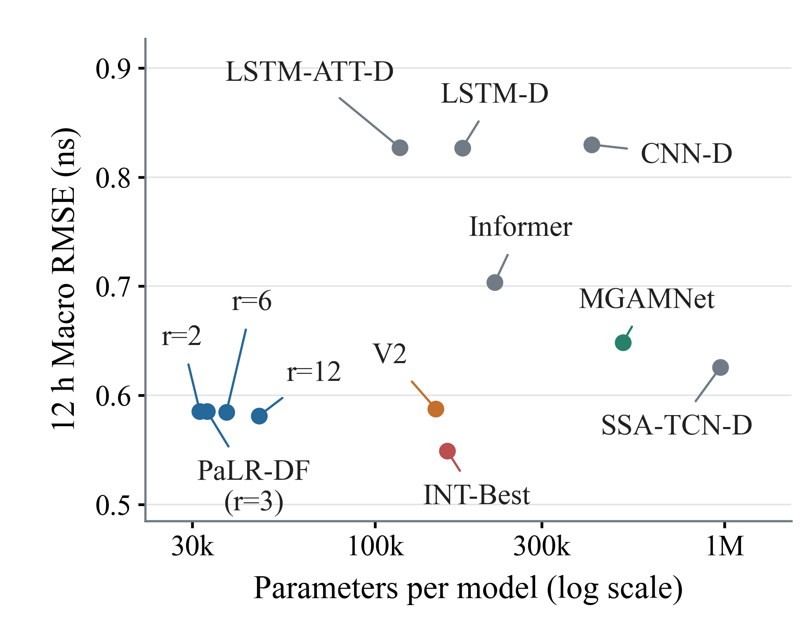

# PaLR-DF

**Persistence-augmented low-rank direct forecasting for satellite clock bias.**

[](LICENSE)


Code and reproducibility artifacts for **Long-Horizon Satellite Clock Bias Prediction: From Mapping Redundancy to Low-Rank Decoding**, by Yuanjin Bao, Jifei Tang, and Lanhua Xia (2026 manuscript).

The current source is **v0.1.1**, aligned with the October 22 submission. It uses the unchanged **v0.1.0 data/checkpoint archive** linked below.

[Review guide](docs/reviewer_guide.md) · [Quick start](#quick-start) · [Results](#paper-results) · [Reproduction](docs/reproduction.md) · [Protocol](docs/protocol.md) · [中文指南](docs/README_zh.md)



## What this release provides

- **Compact full-resolution forecasts:** the rank-3 PaLR-DF uses 33,019 parameters for 12 h forecasts and 37,339 for 24 h forecasts, retaining a 30 s output interval.
- **Task-weighted spectral diagnosis:** context variability and the integrated clock-error metric expose compact residual mappings; the V2 reference has ordinary median 95%-energy ranks of 2 and 1.5 at the two horizons.
- **Controlled rank interventions:** complete satellite/seed records show the low-rank accuracy plateau, with separate three-seed sweeps and five-seed representative configurations.
- **Auditable artifacts:** 2,520 comparison records, 1,400 rank-intervention records, 560 spectral records, and 560 pretrained PaLR-DF/V2 checkpoints, with SHA-256 manifests.

This repository covers the first paper's core method, spectra, rank interventions and comparison results. The [review guide](docs/reviewer_guide.md) maps the submitted paper to the released evidence and verification commands. See the [paper-to-artifact map](docs/artifact_map.md) for the exact scope of each verification command.

## Quick start

Use Python 3.11. From the repository root:

```bash
git clone https://github.com/Pony-J/PaLR-DF.git
cd PaLR-DF
python -m venv .venv
# Linux/macOS: source .venv/bin/activate
# Windows PowerShell: .venv\Scripts\Activate.ps1
python -m pip install --upgrade pip
python -m pip install torch==2.5.1 --index-url https://download.pytorch.org/whl/cpu
python -m pip install -r requirements.txt
python -m pip install -e . --no-deps
python -m unittest discover -s tests -v
palr-df verify-results --output runs/tables
palr-df figures --output runs/figures
```

The last three commands use the small source repository only. `verify-results` checks the complete satellite/seed grids, verifies artifact hashes, and rebuilds paper aggregates. It writes a machine-readable verification report and CSV tables. `figures` regenerates all seven result plots (Figs. 2, 5–10) as PNG, PDF and SVG using portable fonts.

### Replay a pretrained model

Download the matching [PaLR-DF-v0.1.0-assets.zip](https://github.com/Pony-J/PaLR-DF/releases/download/v0.1.0/PaLR-DF-v0.1.0-assets.zip) from the [v0.1.0 release](https://github.com/Pony-J/PaLR-DF/releases/tag/v0.1.0). Verify its checksum against [RELEASE_SHA256SUMS.txt](https://github.com/Pony-J/PaLR-DF/releases/download/v0.1.0/RELEASE_SHA256SUMS.txt), and extract it in the repository root. The resulting directory should be `artifacts/`, containing `data/`, `checkpoints/`, `configs/`, and `manifest.json`.

```bash
palr-df verify-assets --assets artifacts
palr-df evaluate --assets artifacts --horizon 12h --seed 2024 --satellites C29 --output runs/replay_C29_12h
palr-df spectrum --assets artifacts --family v2 --horizon 12h --seed 2024 --satellites C29 --output runs/spectrum_C29_12h
```

Evaluation writes the forecast arrays, per-window clock metrics, reference errors and runtime metadata. Spectrum analysis recomputes the ordinary, context-weighted and task-weighted effective ranks from the checkpoint and **training contexts**. A CPU is sufficient for these commands. Default replay tolerances are 0.0002 ns on CPU and 0.000001 ns on CUDA; aggregation from frozen CSV values is checked to 1e-12 ns. See the measured [release validation](results/validation.json).

For the complete original 28-satellite archival replay, pass `--satellites all` and run each horizon and seed 2024–2028. The [reproduction guide](docs/reproduction.md) provides the full matrix command.

## Paper results

Macro RMSE in ns, mean ± **sample standard deviation of the five seed-level satellite macro averages**. Each model/horizon includes the same 28 satellites. These are the manuscript's development-evaluation results under the [documented checkpoint-selection protocol](docs/protocol.md).

| Model | 12 h | 24 h |
|---|---:|---:|
| **PaLR-DF (r = 3)** | **0.585411 ± 0.005251** | **1.102947 ± 0.009901** |
| V2 reference | 0.587716 ± 0.004631 | 1.103825 ± 0.008798 |
| SSA-TCN-D | 0.625936 ± 0.008858 | 1.179606 ± 0.014797 |
| MGAMNet | 0.648511 ± 0.008843 | 1.212626 ± 0.022446 |
| Informer | 0.703710 ± 0.023404 | 1.286271 ± 0.035305 |
| LSTM-D | 0.826926 ± 0.002054 | 1.653273 ± 0.005686 |
| LSTM-ATT-D | 0.827039 ± 0.002414 | 1.654070 ± 0.006705 |
| CNN-D | 0.829864 ± 0.006321 | 1.689775 ± 0.008989 |
| INT-Best reference policy | 0.549133 ± 0.005674 | 0.983616 ± 0.006414 |

PaLR-DF reduces macro RMSE by **6.47% / 6.50%** relative to the evaluated SSA-TCN-D implementation for 12 h / 24 h, using **33,019 vs. 973,632 parameters** for 12 h. INT-Best is a frozen reference policy with satellite-specific choices; its comparison records are included in full. Display names follow the submitted manuscript; archived CSV identifiers are preserved for hash compatibility. Baseline names identify the local direct-forecasting implementations used in the manuscript; [implementation details](docs/protocol.md#comparison-implementations) distinguish them from upstream author code.







## Train and change the residual rank

```bash
palr-df train --config configs/palr_12h.json --data artifacts/data/code_clock.npz --satellite C29 --seed 2024 --device cpu --output runs/train_C29_12h
palr-df train --config configs/palr_12h.json --data artifacts/data/code_clock.npz --satellite C29 --seed 2024 --rank 6 --output runs/train_C29_rank6
```

The 12 h model uses training-target PCA initialization; the 24 h model uses random initialization. Training saves its resolved config, history, best state, metrics and data/checkpoint hashes. Existing nonempty output directories are never overwritten. `--epochs 1` runs a short implementation check and records it as a smoke run. Full training uses the released recipe; numerical agreement of fresh training depends on the PyTorch build and hardware.

## Repository layout

```text
configs/              PaLR-DF, V2 and selected comparison-adapter recipes
src/palr_df/          model, data, training, evaluation and spectrum analysis
results/frozen/       complete numerical records and provenance manifests
docs/                 protocol, data card, model zoo and reproduction guides
tests/                CPU tests of data alignment and mathematical contracts
artifacts/            extracted release assets (ignored by Git)
```

## Data, license and citation

Code is released under [MIT](LICENSE). CODE/IGS clock products retain their provider's [data terms and attribution requirements](DATA_LICENSE.md). The asset package contains selected clock-bias columns from public CODE MGEX products, in nanoseconds with GPS time labels; see the [data card](docs/data.md) and raw-product SHA-256 manifest. Upstream software notices are in [NOTICE](NOTICE).

Please cite the manuscript and credit CODE/IGS when using these artifacts. The paper citation will be updated when a public publication record is available.

```bibtex
@unpublished{bao2026palrdf,
  title  = {Long-Horizon Satellite Clock Bias Prediction: From Mapping Redundancy to Low-Rank Decoding},
  author = {Bao, Yuanjin and Tang, Jifei and Xia, Lanhua},
  year   = {2026},
  note   = {Manuscript; accompanying PaLR-DF research code}
}
```

For questions about a result, open an issue with the command, runtime versions, and generated `report.json`. Please avoid attaching private clock data or credentials.
